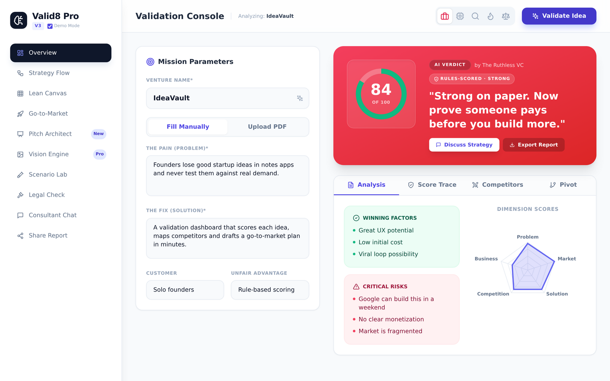
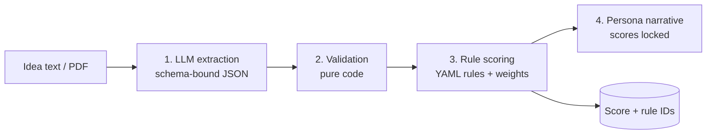
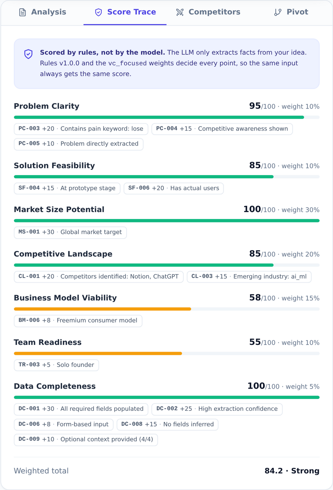
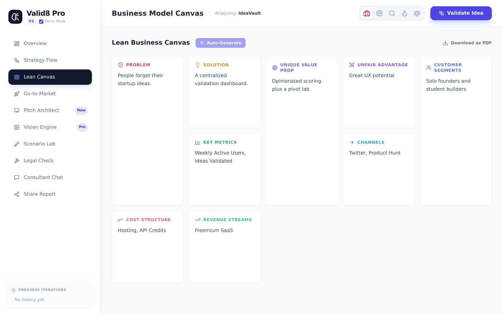

# Valid8 v1: startup idea validation with a deterministic scoring pipeline

Valid8 takes a startup idea (typed or as a PDF pitch deck) and returns a scored validation report: problem, solution, market, competition, business model and team readiness, plus a lean canvas, go-to-market hooks, pivot testing and persona chat.



> **Status:** v1, built Nov to Dec 2025. Superseded by Coldwater (Valid8 v2), a private rebuild. This repo is kept public as a reference for the scoring design.

## The core idea: a 4-layer scoring pipeline

LLMs are good at reading messy input and bad at giving the same number twice. So the model never decides the score: it extracts facts, and versioned rules turn them into points.



| Layer | What it does | LLM? |
|---|---|---|
| 1. Extraction | Pulls structured fields from the idea, validated against `schemas/extraction.schema.json` | Yes, bounded by schema |
| 2. Validation | Schema, enum, compatibility, length and data-quality checks | No |
| 3. Scoring | Rules in `rules/scoring-rules.yaml`, weights in `rules/weights.yaml`. Every point traces to a rule ID (e.g. `MS-003`) | No |
| 4. Presentation | A persona (e.g. ruthless VC) explains the result. Scores are locked by this point | Yes, optional |

The main flow (`POST /api/analyze`) runs Layers 1 to 3 for the score, then a separate LLM call writes the qualitative parts (verdict, competitors, lean canvas, go-to-market). The scores in that LLM output are discarded and replaced by the rules engine's. Every response carries a `scoreTrace`, and the UI shows it in a **Score Trace** tab.

Tests prove it: `tests/test_api_scoring.py` feeds a fake LLM that tries to award 99s and asserts the API ignores them, matches the rules engine exactly, and returns the same trace twice. CI runs the tests and the frontend build on every push.

Code: [`scoring_pipeline/`](scoring_pipeline/) · API: `POST /api/pipeline/analyze`

Every point, traced to the rule that produced it:



To print a trace from the command line: `python scripts/scoring_trace.py`.

## Screenshots
Captured with the app's built-in Demo Mode (no API key needed). The demo's scores and trace are real rules-engine output for the sample idea; its verdict text is sample copy.



## Stack
**Backend:** FastAPI, SQLAlchemy and SQLite, Google Gemini (`google-genai`), PyPDF, ReportLab
**Frontend:** React 18, Vite, Tailwind, Recharts

## Run it

You need Python 3.10+, Node 18+, and a Google AI Studio API key.

```bash
git clone https://github.com/Anirudh-Nadipally/valid8-v1.git
cd valid8-v1

python3 -m venv .venv && source .venv/bin/activate
pip install -r requirements.txt
cp .env.example .env        # add GOOGLE_API_KEY

npm install
```

```bash
python main.py              # API on http://localhost:8000
npm run dev                 # UI on http://localhost:5173
```

On macOS, `start_valid8.command` does all of this in one double-click.

### Tests
```bash
pip install pytest httpx && pytest -q
```

## Limitations (honest)
- The rules are generous: the thin sample idea in the screenshots scores 84 ("Strong") with no revenue and a solo founder.
- The scoring rules are hand-written heuristics and have not been calibrated against real startup outcomes. That gap is why v2 moved to a Facts, Beliefs, Decisions, Outcomes loop.
- The model name is set in `services.py` (`MODEL_NAME`) and may need updating as Gemini models change.
- Single-user local app: no auth, and CORS is open for development.

## API Documentation

Once the backend is running, visit:
- **Swagger UI**: http://localhost:8000/docs
- **ReDoc**: http://localhost:8000/redoc

## Environment Variables

Create a `.env` file in the root directory with the following:

```env
OPENROUTER_API_KEY=your_openrouter_api_key
```

## Project Structure

```
Valid8/
├── main.py                  # FastAPI application entry point
├── models.py                # SQLAlchemy models and Pydantic schemas
├── services.py              # AI client, PDF processor, report generator
├── requirements.txt         # Python dependencies
├── package.json            # Node.js dependencies
├── .env                    # Environment variables (create from .env.example)
├── .env.example            # Environment variables template
├── .gitignore              # Git ignore rules
├── valid8.db               # SQLite database (auto-generated)
│
├── src/                    # Frontend source code
│   ├── App.jsx            # Main React component
│   ├── main.jsx           # React entry point
│   ├── api.js             # API client functions
│   ├── constants.jsx      # Constants and persona definitions
│   ├── index.css          # Global styles
│   └── components/        # React components
│
├── index.html             # HTML entry point
├── vite.config.js         # Vite configuration
├── tailwind.config.js     # TailwindCSS configuration
└── postcss.config.js      # PostCSS configuration
```

## API Endpoints

### Analysis
- `POST /api/analyze` - Analyze a startup idea
- `GET /api/history` - Get analysis history
- `GET /api/report/{id}` - Download PDF report

### Interactive Features
- `POST /api/chat` - Chat with AI persona
- `POST /api/scenario` - Test pivot scenarios
- `POST /api/competitor-weakness` - Analyze competitor weaknesses

### Tools
- `POST /api/pitch-architect` - Generate pitch narrative
- `POST /api/legal-check` - Legal risk assessment
- `POST /api/generate-names` - Generate venture names

## Usage Examples

### Analyzing an Idea (API)

```python
import requests

response = requests.post(
    "http://localhost:8000/api/analyze",
    data={
        "title": "AI-Powered Grocery Assistant",
        "problem": "People waste time planning meals and shopping",
        "solution": "AI suggests recipes and auto-generates shopping lists",
        "targetAudience": "Busy professionals aged 25-45",
        "uniqueValue": "Integration with local stores for real-time pricing",
        "persona": "vc"
    }
)

analysis = response.json()
print(f"Overall Score: {analysis['analysis']['overallScore']}")
```

### Testing a Pivot Scenario

```python
response = requests.post(
    "http://localhost:8000/api/scenario",
    json={
        "analysisId": 1,
        "scenario": "Focus only on meal planning, skip shopping integration",
        "persona": "vc"
    }
)

result = response.json()
print(f"Pivot Verdict: {result['verdict']}")
```

## Available Personas

- **VC**: Venture capitalist perspective focusing on scalability and returns
- **Entrepreneur**: Practical, execution-focused feedback
- **Skeptic**: Critical analysis highlighting potential pitfalls
- **Customer**: End-user perspective on value proposition
- **Technical**: Feasibility and technical implementation assessment

## Development

### Run Linting
```bash
npm run lint
```

### Run Tests (if implemented)
```bash
pytest
```

### Database Migrations

The SQLite database is auto-created on first run. To reset:

```bash
rm valid8.db
python main.py
```

## Troubleshooting

### Backend won't start
- Check Python version: `python --version` (must be 3.8+)
- Verify all dependencies: `pip install -r requirements.txt`
- Check if port 8000 is available: `lsof -i :8000`

### Frontend won't start
- Check Node version: `node --version` (must be 16+)
- Clear node_modules: `rm -rf node_modules && npm install`
- Check if port 5173 is available

### API Key Issues
- Verify `.env` file exists and contains `OPENROUTER_API_KEY`
- Check API key is valid at https://openrouter.ai
- Restart backend server after updating `.env`

### CORS Errors
- Ensure backend is running on port 8000
- Check `api.js` points to correct backend URL

## Contributing

1. Fork the repository
2. Create a feature branch (`git checkout -b feature/amazing-feature`)
3. Commit your changes (`git commit -m 'Add amazing feature'`)
4. Push to the branch (`git push origin feature/amazing-feature`)
5. Open a Pull Request

## License

This project is licensed under the MIT License - see the LICENSE file for details.

## Support

For issues, questions, or contributions:
- Open an issue on GitHub
- Contact: your.email@example.com

## Acknowledgments

- OpenRouter for AI model access
- FastAPI for the excellent Python framework
- React and Vite teams for frontend tools

## Roadmap

- [ ] User authentication and multi-user support
- [ ] Integration with more AI models
- [ ] Advanced analytics dashboard
- [ ] Export to multiple formats (PPT, DOCX)
- [ ] Collaboration features
- [ ] Mobile app
- [ ] API rate limiting and caching
- [ ] Automated competitive intelligence gathering
- [ ] Financial projections module

---

Built with ❤️ for entrepreneurs validating their next big idea.
